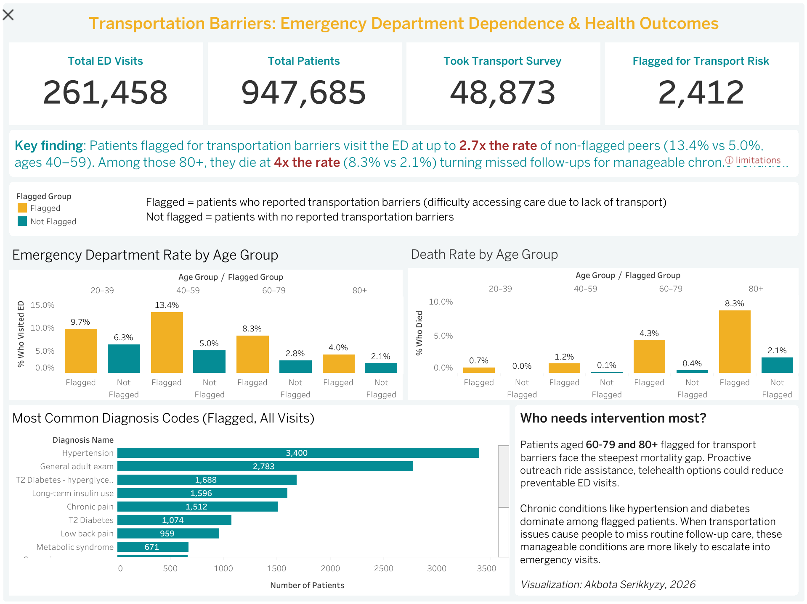

# Transportation Barriers: ED Dependence & Health Outcomes

An interactive Tableau dashboard analyzing how transportation barriers affect
emergency department (ED) dependence and mortality across a patient population,
using survey-flagged transport risk and health outcomes data.

**View the interactive dashboard on Tableau Public:**
https://public.tableau.com/app/profile/akbota.serikkyzy/viz/TransportationBarriersEDDependenceHealthOutcomes/Dashboard2?publish=yes

## Dashboard Preview

## Overview

- **Total patients analyzed:** 947,685
- **Total ED visits:** 261,458
- **Patients who took the transport survey:** 48,873
- **Patients flagged for transportation risk:** 2,412

*Flagged = patients who reported difficulty accessing care due to lack of transport.
Not flagged = patients with no reported transportation barriers.*

## Key Findings

* Flagged patients visit the ED at up to **2.7x the rate** of non-flagged peers
  (13.4% vs 5.0%, ages 40–59).
* Among patients **80+, flagged patients die at 4x the rate** of non-flagged
  peers (8.3% vs 2.1%) — the steepest mortality gap in the dataset.
* Both the ED and mortality gaps **widen with age**, with the 60–79 and 80+
  groups showing the largest differences.
* The most common diagnoses among flagged patients are **chronic, manageable
  conditions**, hypertension, type 2 diabetes, long-term insulin use, and
  chronic pain, rather than acute emergencies.
* This pattern suggests that **missed routine follow-up care escalates into
  preventable ED visits and deaths** when transportation is a barrier.

## Who Needs Intervention Most

Patients aged 60–79 and 80+ flagged for transport barriers face the steepest
mortality gap. Because chronic conditions like hypertension and diabetes dominate
among flagged patients, transportation issues that cause missed follow-ups let
otherwise manageable conditions escalate into emergencies. Proactive outreach,
ride assistance, and telehealth options could reduce preventable ED visits in
these groups.

## Data

The underlying patient-level data is **not publicly disclosed.** It was accessed
under terms that permit sharing this dashboard and analysis, but **not
redistribution of the raw records.** All metrics shown are aggregated and
de-identified; no individual-level data is included in this repository.

## Tools

* **Tableau** — dashboard design and visualization

## Limitations

The flagged group (n = 2,412) is small relative to the full population, and
becomes smaller when split by age and outcome. Rates for the oldest, smallest
cells (e.g., 80+ mortality) rest on modest denominators and should be read as
directional rather than precise. See the dashboard's *limitations* note for detail.

## Author

**Akbota Serikkyzy**
